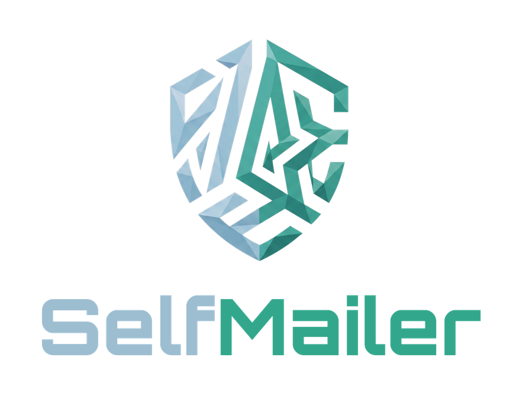

<div align="center">



**Self-hosted, multi-user e-mail client — with calendar, contacts, notes, a native Android app and real-time sync.**<br>
*Selbstgehosteter Mehrbenutzer-Mailclient — mit Kalender, Kontakten, Notizen, nativer Android-App und Echtzeit-Sync.*

[](https://github.com/s3lfcod3r/selfmailer/actions/workflows/ci.yml)


**[🇬🇧 English](#-english) · [🇩🇪 Deutsch](#-deutsch)**

📰 **What's new / Neuigkeiten** → [CHANGELOG.md](CHANGELOG.md)

</div>

---

<a id="-english"></a>

## 🇬🇧 English

A single Docker container that is **not a mail server** — it's a **client** for the mailboxes you already have. It connects to any **IMAP** account to read and to **SMTP** to send, and adds a **calendar, contacts, notes and tasks** on top. A polished **web UI** and a **native Android app** share **one JSON API** — and stay in sync **live** across devices.

Part of the **Self** family (SelfAuthenticator, SelfArchiver, SelfDashboard …) — same design system, same deploy style (GHCR → Unraid).

> **TL;DR** — IMAP/SMTP mail client · calendar/contacts/notes · web + native Android · live cross-device sync · 3 notification options (FCM / ntfy / background) · 2FA · single container · no external DB.

### 📑 Table of contents

[Features](#en-features) · [Blocking senders](#en-blocking) · [Architecture](#en-architecture) · [Notifications](#en-notifications) · [Live sync](#en-live-sync) · [Quick start](#en-quick-start) · [Unraid](#en-unraid) · [Configuration](#en-configuration) · [Backups](#en-backups) · [Android app](#en-android) · [API](#en-api) · [Security](#en-security) · [Tech stack](#en-tech-stack) · [Development](#en-development) · [Roadmap](#en-roadmap)

<a id="en-features"></a>

### ✨ Features

**📬 Mail**
- Multiple **IMAP / SMTP** accounts per user
- **Thunderbird-style** stacked accounts with a per-account folder tree and **unread counters**
- Read **HTML mail** (hardened), download/open **attachments**, **SPF/DKIM/DMARC** spoofing check
- **Compose / reply / forward** with a per-account **From** picker and **signatures**; drafts, read/delivery receipts
- **Star**, mark read/unread, delete, **move**, **cross-account transfer**
- **Multi-select** (long-press → select → bulk move / read / unread / star / delete)
- **Filter rules** (move/star/mark/**delete** — applied automatically on every background sync) and **server-side mailbox migration**
- **Mailbox cleanup**: find similar mail by sender, domain, subject, keyword or label, preview, then move in bulk; **saved search views**
- **Block sender** in one click → mail goes to **trash** (existing + future); a **blocked-senders list** lets you undo any block. Rules also match the **reply-to address** and the **newsletter ID (List-Id)** and show a **hit counter**
- **Auto-empty spam & trash** per account (off / immediately / after 7 / 30 days)
- **Search** with quick filters (unread · has attachment · starred), pagination, snippets
- A local **SQLite cache** kept warm by a background sync → the UI never waits on a slow provider
- **New mail right away** via **IMAP IDLE**: the server reports new mail itself (2-minute polling stays as a safety net); the text of new mail is **prefetched**, so it opens instantly

**🛡️ Spam & virus protection** (Settings → **Security**, everything **off** until you switch it on)
- **Blocks for all accounts** — a sender blocked in one account is removed from all your accounts
- **One-click unsubscribe** for newsletters (RFC 8058) — with a warning when the sender is not verified
- **Virus scan of attachments** with your own **ClamAV** — new mail is checked before it shows up or pushes; infected mail goes to spam, infected downloads are blocked
- **Spam filter** with **rspamd** — rates new mail, moves spam away and **learns from your “Spam” button**

**📅 Organizer**
- **Calendar** — local events, month/agenda views, birthdays from contacts
- **Contacts** — rich address book (phones, address, organisation, website, birthday); import from / export to the phone, optional two-way sync
- **Notes** & **Tasks**
- **CalDAV / CardDAV** pull from external servers (Nextcloud, Synology …) + subscribable **ICS / vCard** export feeds

**🔔 Notifications — you choose**
- **FCM (Google Push)** — instant, no persistent notification (like Gmail/Synology)
- **ntfy** — self-hosted push, no Google
- **Background check** — ~1 min, zero setup
- **Per account, per folder** — pick exactly which mailboxes notify you
- Configurable in **both** the web UI and the app — one shared setting

**🔄 Live sync (SSE)**
- Read/delete/move on your phone → an open web tab **updates instantly** (and vice versa)

**🔐 Security & platform**
- **Multi-user** with admin/user roles; admin can pre-configure accounts for users
- **2FA / TOTP** login with backup codes; biometric **app-lock** on Android
- Account credentials and the **mail cache** **Fernet-encrypted at rest**
- **i18n DE/EN**, light/dark themes + custom accent colours
- **Single container** — FastAPI + SQLite, no external database

<a id="en-blocking"></a>

### 🚫 Blocking senders

**Block a sender** — open the mail → click **⋯** (top right) → **🚫 Block sender** → confirm.
All mail from that sender (existing + future, inbox + spam) is moved to **trash** and marked read.
The trash auto-empties after **7 days** (a safe undo window).

**Undo a block** — click your **👤 user menu** (top right) → **🔀 Rules** → the **🚫 Blocked senders**
box at the top lists every block; hit **↩ Unblock** to let future mail through again.
To recover a specific message, open it in the **Trash** folder and move it back to the inbox (within 7 days).

**Still getting mail from a blocked sender?** Spammers keep changing their address. Under **⚙️ Settings → Security → Spam & virus protection** you can:
- let every block apply to **all your accounts**,
- and under **🔀 Rules** block by **reply-to address** or **newsletter ID (List-Id)** — features spammers change less often than the sender.

Each rule shows **how often it matched** — so you can see whether a block still works.
For real newsletters, the **Unsubscribe** button (same settings page) is the cleaner way out; for unknown senders, blocking is safer, because unsubscribing confirms that your address exists.

> **💡 Tip:** auto-empty timings (spam & trash: off / immediately / after 7 / 30 days) live under **👤 → ✎ Edit account**.

<a id="en-architecture"></a>

### 🧭 Architecture

```text
        ┌──────────────┐          ┌───────────────┐
        │   Web UI     │          │  Android app  │
        │ React + Vite │          │ Kotlin/Compose│
        └──────┬───────┘          └──────┬────────┘
               └───── JSON API + SSE ─────┘
                   /api/v1 · JWT (Bearer)
                          │
                 ┌────────▼─────────┐
                 │   FastAPI core   │  SQLite (cache + config)
                 │  background sync │  Fernet-encrypted secrets
                 │  + event bus     │  in-memory pub/sub → live sync
                 └────────┬─────────┘
        ┌──────────┬──────┴───────┬──────────────┬───────────┐
       IMAP       SMTP     CalDAV / CardDAV      FCM         ntfy
   (read mail) (send mail) (cal & contacts) (Google push) (self-hosted)
```

<a id="en-notifications"></a>

### 🔔 Notifications

Pick a method in **Settings → E-mail notifications** (web *user menu → 🔔* / app *Settings*). The server can drive **all three** in parallel — e.g. FCM on your main phone, ntfy on a de-Googled one.

| Method | Latency | Persistent notification | Needs |
|---|---|---|---|
| **FCM (Google Push)** | instant | none | Firebase project + Google Play Services |
| **ntfy** | instant | none (the ntfy app holds one connection for all apps) | ntfy container + ntfy app |
| **Background check** | ~1 min | yes (Android requirement for a foreground service) | nothing |

**Per folder:** under *Choose folders* you pick, per account, which folders trigger a push.

<details>
<summary><b>Setup — FCM (Google Push)</b></summary>

1. Create a free **Firebase** project at <https://console.firebase.google.com>.
2. **Add Android app** with package name `com.selfmailer.viewer` → download **`google-services.json`** (goes into the app build).
3. Project settings → **Service accounts** → **Generate new private key** → download the JSON.
4. Put that JSON on the server as `…/selfmailer/data/fcm-service-account.json` and set
   `SELFMAILER_FCM_CREDENTIALS=/data/fcm-service-account.json` → restart the container.
5. In the app: notifications on → **Google Push (FCM)** → pick folders → use **Send test push** to verify.

> The push payload is intentionally minimal ("2 new e-mails"); the app fetches the actual content from **your** server, so Google never sees mail bodies.
</details>

<details>
<summary><b>Setup — ntfy (self-hosted)</b></summary>

1. Run an **ntfy** container (e.g. `binwiederhier/ntfy serve`, host port `8095` → container `80`, `NTFY_BASE_URL=http://<host>:8095`).
2. Install the **ntfy app**, add your server, subscribe to the topic SelfMailer shows you.
3. In SelfMailer: notifications on → **ntfy** → enter the URL → **Save & enable** → pick folders.
</details>

<a id="en-live-sync"></a>

### 🔄 Live sync

Every open client (web tab, app in the foreground) holds a thin **SSE** connection (`/api/v1/events/stream`). Whenever anyone performs an action — or new mail arrives — the server emits a tiny event and the other clients refresh the affected folder. No polling storm, no Google, near-instant.

<a id="en-quick-start"></a>

### 🚀 Quick start (Docker)

```bash
cp .env.example .env
# generate a secret and put it in .env (SELFMAILER_SECRET):
python -c "import secrets; print(secrets.token_hex(32))"

docker compose up -d
```

Open `http://<host>:8090` → the **first-run setup** creates the admin account → then add your mail accounts.

> For access from outside your LAN, put a reverse proxy in front: [HTTPS guide](docs/HTTPS.md).

<a id="en-unraid"></a>

### 📦 Unraid

Add the template from
`https://raw.githubusercontent.com/s3lfcod3r/selfmailer/main/unraid/selfmailer.xml`
or import it under *Docker → Add Container → Template*. Set the **Master Secret**, leave the rest on defaults.

> **⚠️ Master Secret:** never change `SELFMAILER_SECRET` after first run — it encrypts the stored mailbox passwords. Changing it makes them unreadable.
>
> **⚠️ Permissions:** the container runs **non-root** (uid `99` / gid `100` = `nobody:users`). If a data file is owned by root, fix it once:
> `chown -R 99:100 /mnt/user/appdata/selfmailer` (or *Tools → Docker Safe New Permissions*).

<a id="en-configuration"></a>

### ⚙️ Configuration

Environment variables, all with the prefix `SELFMAILER_`.

| Variable | Required | Default | Purpose |
|---|---|---|---|
| `SELFMAILER_SECRET` | ✅ | – | JWT signing **and** at-rest encryption of mailbox passwords (≥ 32 chars). **Do not change after setup.** |
| `SELFMAILER_DB_PATH` | – | `/data/selfmailer.db` | SQLite path |
| `SELFMAILER_FCM_CREDENTIALS` | – | `/data/fcm-service-account.json` | Firebase service-account JSON for Google push. Empty/missing = FCM off. |
| `SELFMAILER_TRANSLATE_URL` | – | – | Self-hosted LibreTranslate URL for in-app translation (e.g. `http://192.168.1.10:5000`). Empty = off (button hidden). |
| `SELFMAILER_TRANSLATE_API_KEY` | – | – | Optional API key, only if your LibreTranslate instance requires one |
| `SELFMAILER_ADMIN_TOKEN` | – | – | If set, first-run admin setup requires this token |
| `SELFMAILER_BASE_URL` | – | – | Public base URL (e.g. for feed links) |
| `SELFMAILER_SYNC_INTERVAL` | – | `120` | Seconds between background mail syncs (lower = faster push & sync) |
| `SELFMAILER_IDLE` | – | `1` | IMAP IDLE on the inbox: new mail is reported by the server right away (one extra connection per account); `0` = off |
| `SELFMAILER_PREFETCH_NEW` | – | `20` | Prefetch the full text of up to N new inbox mails per run (≤ 1 MB each, not marked as read); `0` = off |
| `SELFMAILER_CLAMAV` | – | – | ClamAV (clamd) `host:port` for scanning attachments, e.g. `192.168.1.10:3310`. LAN only – clamd has no password. Users switch it on under Settings → Security. |
| `SELFMAILER_RSPAMD_URL` | – | – | rspamd scanner (port 11333) for the spam filter. Users switch it on under Settings → Security. |
| `SELFMAILER_RSPAMD_CONTROLLER_URL` / `SELFMAILER_RSPAMD_PASSWORD` | – | – | Optional: rspamd controller (port 11334) + password so the "Spam" button teaches rspamd. |
| `SELFMAILER_DAV_SYNC_INTERVAL` | – | `120` | Seconds between calendar/contact (DAV) syncs — separate from mail, min 30 |
| `SELFMAILER_SYNC_DISABLE` | – | `0` | Turn off the background sync |
| `SELFMAILER_IMAP_TIMEOUT` | – | `15` | IMAP socket timeout (seconds) |
| `SELFMAILER_DAV_BLOCK_PRIVATE` | – | `false` | Block private/LAN targets for DAV pull (SSRF strict mode) |
| `SELFMAILER_JWT_ALGORITHM` | – | `HS256` | `HS256` / `HS384` / `HS512` |
| `SELFMAILER_BACKUP_ENABLED` | – | `true` | Nightly automatic DB backup (~03:00) |
| `SELFMAILER_BACKUP_KEEP` | – | `7` | How many backups to keep (`0` = keep all) |

<a id="en-backups"></a>

### 💾 Backups

The scheduler takes a **consistent** nightly snapshot of the SQLite database (`sqlite3` online-backup API, safe during writes) into `data/backups/`:

```text
data/backups/selfmailer-YYYYMMDD-HHMMSS.db
```

Only the last `SELFMAILER_BACKUP_KEEP` snapshots are kept; the folder is git-ignored.

**Restore** — stop the container, replace the live DB with a snapshot, start again:

```bash
docker stop selfmailer
cp data/backups/selfmailer-20260101-030000.db data/selfmailer.db
# remove stale WAL/SHM sidecars so the restored file is authoritative
rm -f data/selfmailer.db-wal data/selfmailer.db-shm
docker start selfmailer
```

<a id="en-android"></a>

### 📱 Android app

A real native client (`android/SelfMailer.apk`) — **not** a web-view wrapper. Built like Synology MailPlus:

- **Hamburger drawer** → account switcher + special folders + sub-folders, with unread badges
- **Bottom navigation**: Mail · Calendar · Notes
- HTML mail, attachments, **multi-select** with a bulk action bar, **search filters**, Synology-style **compose** with From picker
- **Drafts are kept** (encrypted locally) even after app-lock or restart
- **Contacts**: import from / export to the phone, optional two-way sync
- **Biometric app-lock** (face / fingerprint / device PIN), unread accent markers
- **Notifications**: FCM / ntfy / background — your choice, per folder
- Talks to the same `/api/v1` as the web UI; server URL entered on first launch

<a id="en-api"></a>

### 🔌 API overview

Base path `/api/v1`, authentication via JWT Bearer. Interactive docs: `http://<host>:8090/docs`.

| Group | Endpoints (excerpt) |
|---|---|
| **Auth** | `auth/status`, `auth/setup`, `auth/login`, `auth/login/totp`, `auth/me`, `auth/totp/*` |
| **Accounts** | `accounts` (CRUD), `accounts/{id}/test` |
| **Mail** | `mail/{id}/folders[/counts]`, `mail/{id}/messages`, `…/{uid}`, `…/flags`, `…/move`, `…/send`, `…/transfer`, `…/batch-*` |
| **Organizer** | `calendar/events`, `contacts`, `notes`, `tasks` |
| **DAV / Feeds** | `dav/accounts`, `feeds/token`, `calendar/export.ics`, `contacts/export.vcf` |
| **Push** | `push` (ntfy), `push/folders` (per-account folders), `push/device` (FCM tokens), `push/test` |
| **Live** | `events/stream` (Server-Sent Events) |
| **Dashboard** | `dashboard/summary` (bundled unseen counts) |

<a id="en-security"></a>

### 🛡️ Security

- Login passwords **Argon2**-hashed; mailbox & DAV passwords **Fernet-encrypted at rest** (key from `SELFMAILER_SECRET`)
- **Data at rest**: the mail cache (subject, sender, preview, full text) and scheduled mails are encrypted; database and backups readable by the container user only
- **IMAP certificates verified**, optionally pinned per account (fingerprint) for self-signed LAN servers
- **Revocable sessions**: logout, password/2FA changes and admin locks revoke tokens, SSE access and push registrations; **CSRF protection** for cookie sessions
- **JWT** pinned to `HS256/384/512`; the 2FA intermediate token grants no access
- **Rate limiting** on login/2FA/setup; defensive response headers; API responses `Cache-Control: no-store`; **anti-enumeration** dummy hash
- **SSRF guard** with IP pinning on DAV pull, ntfy, translation and unsubscribe (loopback/link-local/cloud-metadata always blocked; unsubscribe only to public addresses); DAV credentials stay bound to their origin
- **Container**: non-root (uid 99), app code read-only, no Linux capabilities (`no-new-privileges`, `cap-drop=ALL`), base images pinned by digest, **Trivy** image scan and dependency audits in CI
- **Virus scan** never reports “clean” without a real scan — errors and oversized files are marked “not checked”
- Android: `allowBackup=false`, token in the **Android Keystore**, hardened mail-HTML WebView (no JavaScript, no form submission), FileProvider with path-traversal check
- **Deliberate LAN trade-offs** (documented): cleartext HTTP allowed (HTTPS optional in the container or via a reverse proxy), `SELFMAILER_SECRET` doubles as the encryption seed

Security update history → [CHANGELOG.md](CHANGELOG.md) (entries marked 🔒).

<a id="en-tech-stack"></a>

### 🧱 Tech stack

| Part | Tech |
|---|---|
| Backend | FastAPI · SQLModel · SQLite (WAL) · httpx · aiosmtplib · imap-tools · PyJWT |
| Web | React · Vite · TypeScript · EventSource (SSE) |
| App | Kotlin · Jetpack Compose · OkHttp · WorkManager · Firebase Messaging · BiometricPrompt |
| Push | FCM (Google) · ntfy (self-hosted) |
| Deploy | Docker (multi-stage, non-root) · GHCR · Unraid |

<a id="en-development"></a>

### 🛠️ Development

```bash
# Backend
cd backend && pip install -r requirements.txt
export SELFMAILER_SECRET=$(python -c "import secrets; print(secrets.token_hex(32))")
uvicorn app.main:app --reload --port 8090

# Web (second terminal)
cd frontend && npm install && npm run dev   # http://localhost:5173, proxies /api → :8090
```

**Tests:**

```bash
cd backend && pip install -r requirements.txt -r requirements-dev.txt && pytest --cov=app
```

<a id="en-roadmap"></a>

### 🗺️ Roadmap

- [x] Mail (IMAP/SMTP) · stacked accounts · folder tree + unread counts
- [x] Calendar · Contacts · Notes · Tasks · CalDAV/CardDAV + ICS/vCard feeds
- [x] 2FA / TOTP · filter rules · cross-account transfer · multi-select · search filters
- [x] Native Android app (Synology-style, biometric lock)
- [x] Notifications: **FCM** + **ntfy** + background, per account & folder
- [x] **Live sync** (SSE) between web clients **and** the Android app (foreground)
- [x] Calendar month grid in the app
- [x] Mailbox cleanup · saved views · phone contact import/export/sync
- [x] [HTTPS reverse-proxy guide](docs/HTTPS.md)
- [ ] OAuth for Gmail / Outlook
- [ ] Tests toward 80 % coverage

<p align="right"><a href="#-english">⬆ back to top</a></p>

---

<a id="-deutsch"></a>

## 🇩🇪 Deutsch

Ein einzelner Docker-Container, der **kein Mailserver** ist — sondern ein **Client** für die Postfächer, die du schon hast. Er verbindet sich mit jedem **IMAP**-Konto zum Lesen und mit **SMTP** zum Senden und bringt **Kalender, Kontakte, Notizen und Aufgaben** mit. Eine ausgefeilte **Web-Oberfläche** und eine **native Android-App** teilen sich **eine JSON-API** — und bleiben **live** über Geräte hinweg synchron.

Teil der **Self**-Familie (SelfAuthenticator, SelfArchiver, SelfDashboard …) — gleiches Design-System, gleicher Deploy-Stil (GHCR → Unraid).

> **Kurz** — IMAP/SMTP-Mailclient · Kalender/Kontakte/Notizen · Web + native Android · Live-Sync zwischen Geräten · 3 Benachrichtigungswege (FCM / ntfy / Hintergrund) · 2FA · ein Container · keine externe DB.

### 📑 Inhaltsverzeichnis

[Funktionen](#de-funktionen) · [Absender blockieren](#de-blockieren) · [Architektur](#de-architektur) · [Benachrichtigungen](#de-benachrichtigungen) · [Live-Sync](#de-live-sync) · [Schnellstart](#de-schnellstart) · [Unraid](#de-unraid) · [Konfiguration](#de-konfiguration) · [Backups](#de-backups) · [Android-App](#de-android) · [API](#de-api) · [Sicherheit](#de-sicherheit) · [Tech-Stack](#de-tech-stack) · [Entwicklung](#de-entwicklung) · [Roadmap](#de-roadmap)

<a id="de-funktionen"></a>

### ✨ Funktionen

**📬 Mail**
- Mehrere **IMAP-/SMTP**-Konten pro Nutzer
- **Thunderbird-Ansicht**: gestapelte Konten mit Ordnerbaum und **Ungelesen-Zählern**
- **HTML-Mails** lesen (gehärtet), **Anhänge** öffnen, **SPF/DKIM/DMARC**-Spoofing-Check
- **Schreiben / Antworten / Weiterleiten** mit **Absender-Auswahl** und **Signaturen**; Entwürfe, Lese-/Empfangsbestätigung
- **Stern**, gelesen/ungelesen, löschen, **verschieben**, **kontoübergreifend übertragen**
- **Mehrfachauswahl** (lange drücken → auswählen → Sammelaktionen Verschieben/Gelesen/Ungelesen/Stern/Löschen)
- **Filterregeln** (Verschieben/Stern/Gelesen/**Löschen** — bei jedem Hintergrund-Sync automatisch angewandt) und serverseitige **Postfach-Migration**
- **Postfach aufräumen**: ähnliche Mails nach Absender, Domain, Betreff, Stichwort oder Label finden, Vorschau prüfen, dann gesammelt verschieben; **gespeicherte Suchansichten**
- **Absender blockieren** per Klick → Mails wandern in den **Papierkorb** (vorhandene + künftige); eine **Liste blockierter Absender** macht jede Blockierung rückgängig. Regeln greifen auch auf die **Antwort-Adresse** und die **Newsletter-Kennung (List-Id)** und zeigen einen **Trefferzähler**
- **Spam & Papierkorb automatisch leeren** je Konto (aus / sofort / nach 7 / 30 Tagen)
- **Suche** mit Schnellfiltern (ungelesen · Anhang · Stern), Seitenweise Anzeige, Vorschauen
- Lokaler **SQLite-Cache**, vom Hintergrund-Sync warmgehalten → die Oberfläche wartet nie auf einen langsamen Anbieter
- **Neue Mails sofort** per **IMAP IDLE**: der Server meldet neue Mails selbst (die Abfrage alle 2 Minuten bleibt als Sicherheitsnetz); der Text neuer Mails wird **vorgeladen** und öffnet sich ohne Wartezeit

**🛡️ Spam- & Virenschutz** (Einstellungen → **Sicherheit**, alles **aus**, bis du es einschaltest)
- **Sperren für alle Konten** — ein in einem Konto gesperrter Absender verschwindet aus allen deinen Konten
- **Abmelden mit einem Klick** für Newsletter (RFC 8058) — mit Warnung, wenn der Absender nicht geprüft ist
- **Virenscan der Anhänge** mit deinem eigenen **ClamAV** — neue Mails werden geprüft, bevor sie erscheinen oder pushen; infizierte Mails wandern in den Spam-Ordner, infizierte Downloads werden gesperrt
- **Spamfilter** mit **rspamd** — bewertet neue Mails, verschiebt Spam und **lernt mit deinem „Spam"-Knopf**

**📅 Organizer**
- **Kalender** — lokale Termine, Monats-/Agenda-Ansicht, Geburtstage aus Kontakten
- **Kontakte** — umfangreiches Adressbuch (Telefon, Adresse, Firma, Website, Geburtstag); Import vom / Export aufs Handy, optional Sync in beide Richtungen
- **Notizen** & **Aufgaben**
- **CalDAV-/CardDAV**-Abgleich mit externen Servern (Nextcloud, Synology …) + abonnierbare **ICS-/vCard**-Feeds

**🔔 Benachrichtigungen — du wählst**
- **FCM (Google-Push)** — sofort, keine Dauer-Benachrichtigung (wie Gmail/Synology)
- **ntfy** — selbstgehosteter Push, kein Google
- **Hintergrund-Prüfung** — ~1 Min, keine Einrichtung nötig
- **Pro Konto, pro Ordner** — du wählst genau, welche Postfächer benachrichtigen
- Einstellbar in **Web-Oberfläche und App** — eine gemeinsame Einstellung

**🔄 Live-Sync (SSE)**
- Lesen/Löschen/Verschieben am Handy → ein offener Web-Tab **aktualisiert sich sofort** (und umgekehrt)

**🔐 Sicherheit & Plattform**
- **Mehrbenutzer** mit Admin-/Nutzer-Rollen; der Admin kann Konten vorkonfigurieren
- **2FA / TOTP** mit Backup-Codes; biometrische **App-Sperre** unter Android
- Konto-Zugangsdaten und **Mail-Cache** **Fernet-verschlüsselt** gespeichert
- **Deutsch/Englisch**, helles/dunkles Theme + eigene Akzentfarben
- **Ein Container** — FastAPI + SQLite, keine externe Datenbank

<a id="de-blockieren"></a>

### 🚫 Absender blockieren

**Blockieren** — Mail öffnen → oben rechts auf **⋯** → **🚫 Absender blockieren** → bestätigen.
Alle Mails dieses Absenders (vorhandene + künftige, Posteingang + Spam) wandern in den **Papierkorb** und werden als gelesen markiert.
Der Papierkorb leert sich nach **7 Tagen** automatisch (Rückgängig-Fenster).

**Aufheben** — oben rechts aufs **👤 Benutzermenü** → **🔀 Regeln** → der Kasten **🚫 Blockierte Absender**
ganz oben zeigt alle Blockierungen; mit **↩ Aufheben** kommen künftige Mails wieder an.
Eine einzelne Mail rettest du, indem du sie im Ordner **Papierkorb** öffnest und zurück in den Posteingang verschiebst (innerhalb der 7 Tage).

**Kommen trotzdem Mails vom gesperrten Absender?** Spammer wechseln ständig ihre Adresse. Unter **⚙️ Einstellungen → Sicherheit → Spam- & Virenschutz** kannst du:
- jede Sperre für **alle deine Konten** gelten lassen,
- und unter **🔀 Regeln** nach **Antwort-Adresse** oder **Newsletter-Kennung (List-Id)** sperren — Merkmale, die Spammer seltener wechseln als den Absender.

Jede Regel zeigt, **wie oft sie zugeschlagen hat** — so siehst du, ob eine Sperre noch wirkt.
Bei echten Newslettern ist der **Abmelden**-Knopf (gleiche Einstellungsseite) der sauberere Weg; bei Unbekannten ist Sperren sicherer, denn Abmelden bestätigt, dass deine Adresse existiert.

> **💡 Tipp:** die Zeiten fürs automatische Leeren (Spam & Papierkorb: aus / sofort / nach 7 / 30 Tagen) findest du unter **👤 → ✎ Konto bearbeiten**.

<a id="de-architektur"></a>

### 🧭 Architektur

```text
        ┌──────────────┐          ┌───────────────┐
        │  Web-UI      │          │  Android-App  │
        │ React + Vite │          │ Kotlin/Compose│
        └──────┬───────┘          └──────┬────────┘
               └───── JSON-API + SSE ─────┘
                   /api/v1 · JWT (Bearer)
                          │
                 ┌────────▼─────────┐
                 │  FastAPI-Kern    │  SQLite (Cache + Konfiguration)
                 │ Hintergrund-Sync │  Fernet-verschlüsselte Geheimnisse
                 │  + Event-Bus     │  In-Memory-Pub/Sub → Live-Sync
                 └────────┬─────────┘
        ┌──────────┬──────┴───────┬──────────────┬───────────┐
       IMAP       SMTP     CalDAV / CardDAV      FCM         ntfy
  (Mail lesen) (Mail senden) (Kal. & Kontakte) (Google-Push) (selbstgehostet)
```

<a id="de-benachrichtigungen"></a>

### 🔔 Benachrichtigungen

Methode unter **Einstellungen → E-Mail-Benachrichtigungen** wählen (Web *Benutzermenü → 🔔* / App *Einstellungen*). Der Server bedient **alle drei** parallel — z. B. FCM aufs Haupt-Handy, ntfy auf ein Handy ohne Google.

| Methode | Latenz | Dauer-Benachrichtigung | Voraussetzung |
|---|---|---|---|
| **FCM (Google-Push)** | sofort | keine | Firebase-Projekt + Google-Play-Dienste |
| **ntfy** | sofort | keine (die ntfy-App hält eine Verbindung für alle Apps) | ntfy-Container + ntfy-App |
| **Hintergrund-Prüfung** | ~1 Min | ja (Android-Pflicht für einen Vordergrund-Dienst) | nichts |

**Pro Ordner:** unter *Ordner auswählen* legst du je Konto fest, welche Ordner einen Push auslösen.

<details>
<summary><b>Einrichtung — FCM (Google-Push)</b></summary>

1. Kostenloses **Firebase**-Projekt anlegen: <https://console.firebase.google.com>.
2. **Android-App hinzufügen** mit Paketname `com.selfmailer.viewer` → **`google-services.json`** herunterladen (kommt in den App-Build).
3. Projekteinstellungen → **Dienstkonten** → **Neuen privaten Schlüssel generieren** → JSON herunterladen.
4. Diese JSON auf dem Server als `…/selfmailer/data/fcm-service-account.json` ablegen und
   `SELFMAILER_FCM_CREDENTIALS=/data/fcm-service-account.json` setzen → Container neu starten.
5. In der App: Benachrichtigungen an → **Google-Push (FCM)** → Ordner wählen → mit **Test-Push senden** prüfen.

> Der Push-Inhalt ist bewusst minimal („2 neue E-Mails“); die App holt die Details direkt von **deinem** Server — Google sieht keine Mail-Inhalte.
</details>

<details>
<summary><b>Einrichtung — ntfy (selbstgehostet)</b></summary>

1. **ntfy**-Container starten (z. B. `binwiederhier/ntfy serve`, Host-Port `8095` → Container `80`, `NTFY_BASE_URL=http://<host>:8095`).
2. **ntfy-App** installieren, Server eintragen, das in SelfMailer angezeigte Thema abonnieren.
3. In SelfMailer: Benachrichtigungen an → **ntfy** → URL eintragen → **Speichern & aktivieren** → Ordner wählen.
</details>

<a id="de-live-sync"></a>

### 🔄 Live-Sync

Jeder offene Client (Web-Tab, App im Vordergrund) hält eine schlanke **SSE**-Verbindung (`/api/v1/events/stream`). Führt jemand eine Aktion aus — oder kommt neue Mail an — schickt der Server ein kleines Event, und die anderen Clients aktualisieren den betroffenen Ordner. Kein Dauer-Polling, kein Google, quasi sofort.

<a id="de-schnellstart"></a>

### 🚀 Schnellstart (Docker)

```bash
cp .env.example .env
# Secret erzeugen und in .env eintragen (SELFMAILER_SECRET):
python -c "import secrets; print(secrets.token_hex(32))"

docker compose up -d
```

`http://<host>:8090` öffnen → die **Ersteinrichtung** legt das Admin-Konto an → danach deine Mailkonten hinzufügen.

> Für Zugriff von außerhalb des LANs einen Reverse Proxy davorschalten: [HTTPS-Anleitung](docs/HTTPS.md).

<a id="de-unraid"></a>

### 📦 Unraid

Vorlage von
`https://raw.githubusercontent.com/s3lfcod3r/selfmailer/main/unraid/selfmailer.xml`
hinzufügen oder unter *Docker → Add Container → Template* importieren. **Master Secret** setzen, den Rest auf Standard lassen.

> **⚠️ Master Secret:** `SELFMAILER_SECRET` nach dem ersten Start **nie ändern** — damit werden die gespeicherten Postfach-Passwörter verschlüsselt. Eine Änderung macht sie unlesbar.
>
> **⚠️ Rechte:** der Container läuft **ohne Root** (uid `99` / gid `100` = `nobody:users`). Gehört eine Datendatei root, einmalig korrigieren:
> `chown -R 99:100 /mnt/user/appdata/selfmailer` (oder *Tools → Docker Safe New Permissions*).

<a id="de-konfiguration"></a>

### ⚙️ Konfiguration

Umgebungsvariablen, alle mit dem Präfix `SELFMAILER_`.

| Variable | Pflicht | Standard | Zweck |
|---|---|---|---|
| `SELFMAILER_SECRET` | ✅ | – | JWT-Signatur **und** Verschlüsselung der gespeicherten Postfach-Passwörter (≥ 32 Zeichen). **Nach der Einrichtung nicht ändern.** |
| `SELFMAILER_DB_PATH` | – | `/data/selfmailer.db` | SQLite-Pfad |
| `SELFMAILER_FCM_CREDENTIALS` | – | `/data/fcm-service-account.json` | Firebase-Service-Account-JSON für Google-Push. Leer/fehlend = FCM aus. |
| `SELFMAILER_TRANSLATE_URL` | – | – | URL einer selbstgehosteten LibreTranslate-Instanz für die Übersetzung in der App (z. B. `http://192.168.1.10:5000`). Leer = aus (Button ausgeblendet). |
| `SELFMAILER_TRANSLATE_API_KEY` | – | – | Optionaler API-Key, nur falls deine LibreTranslate-Instanz einen verlangt |
| `SELFMAILER_ADMIN_TOKEN` | – | – | Wenn gesetzt, verlangt die Ersteinrichtung diesen Token |
| `SELFMAILER_BASE_URL` | – | – | Öffentliche Basis-URL (z. B. für Feed-Links) |
| `SELFMAILER_SYNC_INTERVAL` | – | `120` | Sekunden zwischen Mail-Syncs im Hintergrund (kleiner = schnellerer Push & Sync) |
| `SELFMAILER_IDLE` | – | `1` | IMAP IDLE auf dem Posteingang: der Server meldet neue Mails sofort (eine zusätzliche Verbindung je Konto); `0` = aus |
| `SELFMAILER_PREFETCH_NEW` | – | `20` | Volltext von bis zu N neuen Posteingangs-Mails je Lauf vorladen (je ≤ 1 MB, ohne Gelesen-Markierung); `0` = aus |
| `SELFMAILER_CLAMAV` | – | – | ClamAV (clamd) `host:port` für den Virenscan der Anhänge, z. B. `192.168.1.10:3310`. Nur im Heimnetz – clamd hat kein Passwort. Einschalten unter Einstellungen → Sicherheit. |
| `SELFMAILER_RSPAMD_URL` | – | – | rspamd-Scanner (Port 11333) für den Spamfilter. Einschalten unter Einstellungen → Sicherheit. |
| `SELFMAILER_RSPAMD_CONTROLLER_URL` / `SELFMAILER_RSPAMD_PASSWORD` | – | – | Optional: rspamd-Controller (Port 11334) + Passwort, damit der „Spam"-Knopf rspamd anlernt. |
| `SELFMAILER_DAV_SYNC_INTERVAL` | – | `120` | Sekunden zwischen Kalender-/Kontakt-Syncs (DAV) — getrennt vom Mail-Sync, min. 30 |
| `SELFMAILER_SYNC_DISABLE` | – | `0` | Hintergrund-Sync abschalten |
| `SELFMAILER_IMAP_TIMEOUT` | – | `15` | IMAP-Socket-Timeout (Sekunden) |
| `SELFMAILER_DAV_BLOCK_PRIVATE` | – | `false` | Private/LAN-Ziele beim DAV-Abgleich blockieren (strenger SSRF-Modus) |
| `SELFMAILER_JWT_ALGORITHM` | – | `HS256` | `HS256` / `HS384` / `HS512` |
| `SELFMAILER_BACKUP_ENABLED` | – | `true` | Nächtliches automatisches DB-Backup (~03:00) |
| `SELFMAILER_BACKUP_KEEP` | – | `7` | Anzahl behaltener Backups (`0` = alle behalten) |

<a id="de-backups"></a>

### 💾 Backups

Der Scheduler erstellt nachts ein **konsistentes** Backup der SQLite-Datenbank (`sqlite3`-Online-Backup-API, sicher auch während Schreibvorgängen) in `data/backups/`:

```text
data/backups/selfmailer-YYYYMMDD-HHMMSS.db
```

Es werden nur die letzten `SELFMAILER_BACKUP_KEEP` Backups behalten; der Ordner ist git-ignoriert.

**Wiederherstellen** — Container stoppen, die Live-DB durch ein Backup ersetzen, neu starten:

```bash
docker stop selfmailer
cp data/backups/selfmailer-20260101-030000.db data/selfmailer.db
# veraltete WAL/SHM-Dateien entfernen, damit die wiederhergestellte Datei gilt
rm -f data/selfmailer.db-wal data/selfmailer.db-shm
docker start selfmailer
```

<a id="de-android"></a>

### 📱 Android-App

Ein echter nativer Client (`android/SelfMailer.apk`) — **kein** WebView-Wrapper. Aufgebaut wie Synology MailPlus:

- **Seitenmenü** → Kontowechsel + Sonderordner + Unterordner, mit Ungelesen-Badges
- **Untere Navigation**: Mail · Kalender · Notizen
- HTML-Mail, Anhänge, **Mehrfachauswahl** mit Aktionsleiste, **Suchfilter**, **Verfassen** im Synology-Stil mit Absender-Auswahl
- **Entwürfe bleiben erhalten** (lokal verschlüsselt), auch nach App-Sperre oder Neustart
- **Kontakte**: Import vom / Export aufs Handy, optional Sync in beide Richtungen
- **Biometrische App-Sperre** (Gesicht / Fingerabdruck / Geräte-PIN), farbige Markierung für Ungelesenes
- **Benachrichtigungen**: FCM / ntfy / Hintergrund — deine Wahl, pro Ordner
- Nutzt dieselbe `/api/v1` wie die Web-Oberfläche; Server-URL beim ersten Start eingeben

<a id="de-api"></a>

### 🔌 API-Übersicht

Basispfad `/api/v1`, Anmeldung per JWT Bearer. Interaktive Doku: `http://<host>:8090/docs`.

| Bereich | Endpunkte (Auszug) |
|---|---|
| **Auth** | `auth/status`, `auth/setup`, `auth/login`, `auth/login/totp`, `auth/me`, `auth/totp/*` |
| **Konten** | `accounts` (CRUD), `accounts/{id}/test` |
| **Mail** | `mail/{id}/folders[/counts]`, `mail/{id}/messages`, `…/{uid}`, `…/flags`, `…/move`, `…/send`, `…/transfer`, `…/batch-*` |
| **Organizer** | `calendar/events`, `contacts`, `notes`, `tasks` |
| **DAV / Feeds** | `dav/accounts`, `feeds/token`, `calendar/export.ics`, `contacts/export.vcf` |
| **Push** | `push` (ntfy), `push/folders` (Ordner je Konto), `push/device` (FCM-Tokens), `push/test` |
| **Live** | `events/stream` (Server-Sent Events) |
| **Dashboard** | `dashboard/summary` (gebündelte Ungelesen-Zähler) |

<a id="de-sicherheit"></a>

### 🛡️ Sicherheit

- Login-Passwörter mit **Argon2** gehasht; Postfach- & DAV-Passwörter **Fernet-verschlüsselt** gespeichert (Schlüssel aus `SELFMAILER_SECRET`)
- **Daten im Ruhezustand**: Mail-Cache (Betreff, Absender, Vorschau, Volltext) und geplante Mails verschlüsselt; Datenbank und Backups nur für den Container-Nutzer lesbar
- **IMAP-Zertifikate werden geprüft**, für selbstsignierte LAN-Server optional pro Konto per Fingerprint festgelegt
- **Widerrufbare Sitzungen**: Logout, Passwort-/2FA-Änderungen und Admin-Sperren widerrufen Tokens, SSE-Zugriff und Push-Registrierungen; **CSRF-Schutz** für Cookie-Sitzungen
- **JWT** fest auf `HS256/384/512`; der 2FA-Zwischentoken gewährt keinen Zugriff
- **Rate-Limiting** bei Login/2FA/Einrichtung; defensive Response-Header; API-Antworten mit `Cache-Control: no-store`; **Schutz gegen Nutzer-Ausspähung** (Dummy-Hash)
- **SSRF-Schutz** mit IP-Pinning bei DAV-Abgleich, ntfy, Übersetzung und Abmelden (Loopback/Link-Local/Cloud-Metadaten immer blockiert; Abmelden nur an öffentliche Adressen); DAV-Zugangsdaten bleiben am Origin
- **Container**: ohne Root (uid 99), App-Code schreibgeschützt, keine Linux-Sonderrechte (`no-new-privileges`, `cap-drop=ALL`), Basis-Images per Digest festgelegt, **Trivy**-Image-Scan und Abhängigkeits-Audits in der CI
- **Virenscan** meldet nie „sauber" ohne echten Scan — Fehler und zu große Dateien gelten als „nicht geprüft"
- Android: `allowBackup=false`, Token im **Android-Keystore**, gehärtete Mail-HTML-WebView (kein JavaScript, keine Formulare), FileProvider mit Path-Traversal-Prüfung
- **Bewusste LAN-Kompromisse** (dokumentiert): unverschlüsseltes HTTP erlaubt (HTTPS optional im Container oder über einen Reverse-Proxy), `SELFMAILER_SECRET` ist zugleich der Verschlüsselungs-Seed

Verlauf der Sicherheitsupdates → [CHANGELOG.md](CHANGELOG.md) (Einträge mit 🔒).

<a id="de-tech-stack"></a>

### 🧱 Tech-Stack

| Teil | Technik |
|---|---|
| Backend | FastAPI · SQLModel · SQLite (WAL) · httpx · aiosmtplib · imap-tools · PyJWT |
| Web | React · Vite · TypeScript · EventSource (SSE) |
| App | Kotlin · Jetpack Compose · OkHttp · WorkManager · Firebase Messaging · BiometricPrompt |
| Push | FCM (Google) · ntfy (selbstgehostet) |
| Deploy | Docker (Multi-Stage, ohne Root) · GHCR · Unraid |

<a id="de-entwicklung"></a>

### 🛠️ Entwicklung

```bash
# Backend
cd backend && pip install -r requirements.txt
export SELFMAILER_SECRET=$(python -c "import secrets; print(secrets.token_hex(32))")
uvicorn app.main:app --reload --port 8090

# Web (zweites Terminal)
cd frontend && npm install && npm run dev   # http://localhost:5173, leitet /api → :8090 weiter
```

**Tests:**

```bash
cd backend && pip install -r requirements.txt -r requirements-dev.txt && pytest --cov=app
```

<a id="de-roadmap"></a>

### 🗺️ Roadmap

- [x] Mail (IMAP/SMTP) · gestapelte Konten · Ordnerbaum + Ungelesen-Zähler
- [x] Kalender · Kontakte · Notizen · Aufgaben · CalDAV/CardDAV + ICS/vCard-Feeds
- [x] 2FA / TOTP · Filterregeln · kontoübergreifend übertragen · Mehrfachauswahl · Suchfilter
- [x] Native Android-App (Synology-Stil, biometrische Sperre)
- [x] Benachrichtigungen: **FCM** + **ntfy** + Hintergrund, pro Konto & Ordner
- [x] **Live-Sync** (SSE) zwischen Web-Clients **und** der Android-App (Vordergrund)
- [x] Kalender-Monatsansicht in der App
- [x] Postfach aufräumen · gespeicherte Ansichten · Handykontakte importieren/exportieren/abgleichen
- [x] [HTTPS-Reverse-Proxy-Anleitung](docs/HTTPS.md)
- [ ] OAuth für Gmail / Outlook
- [ ] Tests Richtung 80 % Abdeckung

<p align="right"><a href="#-deutsch">⬆ nach oben</a></p>

---

<div align="center">

**SelfMailer** · part of the Self family · Teil der Self-Familie<br>
made with 📬 for self-hosting

</div>
